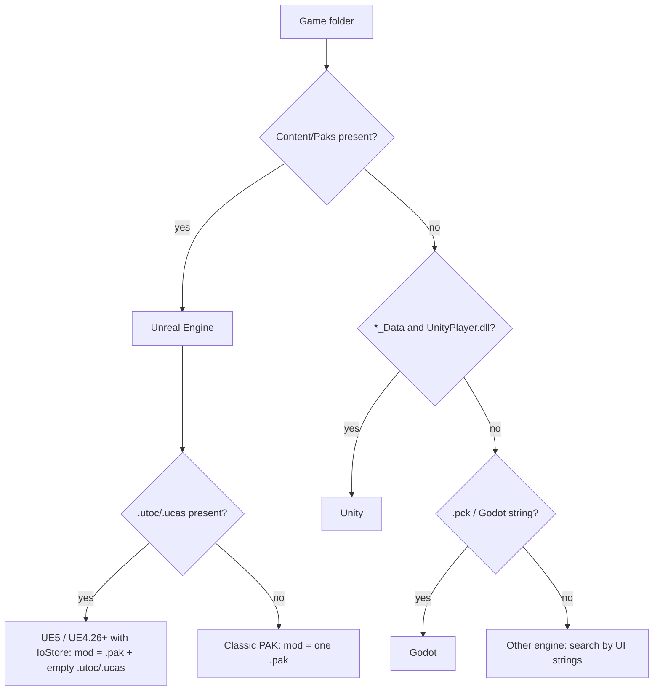

# Engines: how to identify them and where to look for text

[← Contents](../../../README.en.md)

## Identify the engine from the game files

| Sign in the game folder | Engine | Document |
|---|---|---|
| `<Project>/Content/Paks/*.pak`, `*.utoc`, `*.ucas`; `Engine/`; `<Project>.exe` + `<Project>/Binaries/Win64/<Project>-Win64-Shipping.exe` | Unreal Engine 4/5 | [unreal-engine.md](unreal-engine.md) **[verified]** |
| `<Game>_Data/`, `UnityPlayer.dll`, `globalgamemanagers`, `*.assets`, `StreamingAssets/` | Unity | [unity.md](unity.md) **[partly verified]** |
| `*.pck` next to the `.exe` (or embedded in it), string `Godot Engine` in the binary | Godot | [godot.md](godot.md) [overview] |

## Decision tree

## Universal approach for an unknown engine

1. Pick a unique English UI string (a button label, for example).
2. Search the game files for it (`grep -rla "Start New Campaign"`); if files are compressed, search the extracted contents.
3. Check whether files for other languages (`fr`, `de`, `ja`) sit nearby — their structure is the template for the new language.
