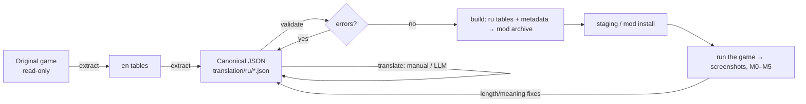

# Translation and verification pipeline

[← Contents](../../README.en.md)



## 1. Stages and order

1. **Reconnaissance (read-only).** Engine version, containers, where the tables are, which languages exist. Hash the originals to prove later that they did not change.
2. **PoC: one string.** Replace one visible string (a main-menu button) in an existing language → see it on screen. This proves the whole path: format, mounting, priority.
3. **PoC: a new language.** Add culture `ru` with that one string → the language appears in settings, the string is visible.
4. **One string per target.** Make sure every target (menu, settings, plugins) picks up its own `ru`.
5. **Mass translation** — only after steps 2–4.
6. **Screenshot iterations:** clipping, wrong context, fonts.

## 2. Canonical format

One JSON per target is the source of truth; binary tables are always built from it.

```json
{
  "format": "l10n/1", "target": "Game", "culture": "ru", "source_culture": "en",
  "entries": [
    {
      "id": "Game/ST_Common_Menu/Menu_Quit",
      "namespace": "ST_Common_Menu", "key": "Menu_Quit",
      "source": "Quit", "source_hash": "0x1A2B3C4D",
      "translation": "Выход",
      "note": "mt:<model> | manual | keep as source"
    }
  ]
}
```

- `translation: ""` — untranslated; the build keeps the source text.
- `extract` is idempotent: keeps translations, marks `stale` when the source text changed after a game update.
- Entries are sorted by (namespace, key) → clean diffs in Git.

## 3. Automatic checks (validate)

| Check | Why it matters |
|---|---|
| placeholders `{…}` — same multiset | a missing `{0}` → blank or broken formatting |
| tags `<…>` / `</>` | broken rich text shows markup as text |
| dialogue script markup (`(#confirm …)`, `[choice]`) | the dialogue script stops working |
| number of `\r`/`\n` | layout of windows and dialogues |
| leading/trailing whitespace | strings get glued to names and numbers |
| source hash matches | otherwise the engine rejects the translation |
| translation = source | warning (often fine for names) |

## 4. Large-volume translation with an LLM

What worked for ~3800 unique strings (~19k words):

- **Deduplication**: identical sources are translated once (5795 → 3825).
- **Order**: name tables first (monsters, locations, items); their translations are fed into later batches as a mini-glossary → consistent names.
- **Glossary** in the system prompt + rules: keep markup, use «ё» and «guillemets», a fixed form of address to the player, gender-neutral wording.
- **Batches** of ~40 strings / ~6000 characters, response is JSON `{id: translation}`; each response is validated immediately and the file is saved after every batch (interrupt and resume at will).
- **Marking** with `note: "mt:<model>"` so proofreading knows what a human has touched.
- Model choice — a short blind test of a few models on 3 strings with markup and dialogue.

Typical machine-translation errors only caught in game: ambiguous words without context (`Chest` → "chest (box)" instead of the "torso" slot, `Pack` → "bundle" instead of the "items" tab), labels too long for narrow columns.

## 5. In-game verification

- Each run gets a code (R1, R2…) and exactly one changed variable.
- Proof the mod was opened: inotify/Process Monitor, a launch-parameter log.
- Outcome — screenshot + an M0–M5 code (see [overview](overview.md#experiment-outcome-scale)).
- After every run — verify the hashes of the originals.
