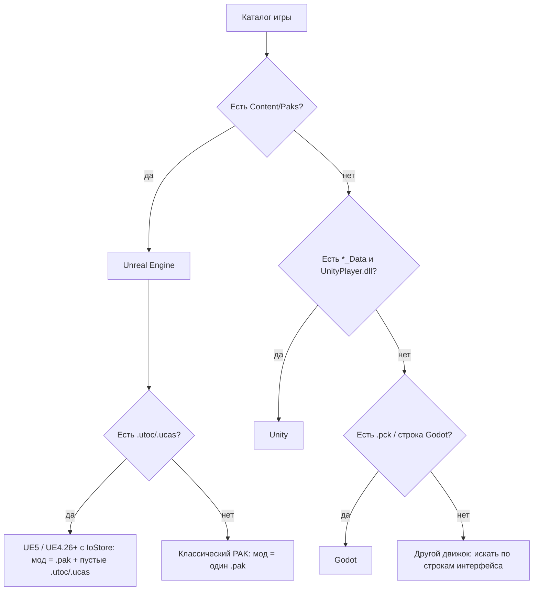

# Движки: как определить и где искать текст

[← К оглавлению](../../../README.md)

## Как определить движок по файлам игры

| Признак в каталоге игры | Движок | Документ |
|---|---|---|
| `<Project>/Content/Paks/*.pak`, `*.utoc`, `*.ucas`; `Engine/`; `<Project>.exe` + `<Project>/Binaries/Win64/<Project>-Win64-Shipping.exe` | Unreal Engine 4/5 | [unreal-engine.md](unreal-engine.md) **[проверено]** |
| `<Game>_Data/`, `UnityPlayer.dll`, `globalgamemanagers`, `*.assets`, `StreamingAssets/` | Unity | [unity.md](unity.md) **[проверено частично]** |
| `*.pck` рядом с `.exe` (или встроен в `.exe`), строка `Godot Engine` в бинарнике | Godot | [godot.md](godot.md) [обзор] |

## Дерево решений

## Универсальный приём для неизвестного движка

1. Найти в игре уникальную английскую строку интерфейса (например, текст кнопки).
2. Поискать её по файлам игры (`grep -rla "Start New Campaign"`), а если файлы сжаты — по распакованному содержимому.
3. Посмотреть, лежат ли рядом файлы других языков (`fr`, `de`, `ja`) — их структура и есть шаблон для нового языка.
