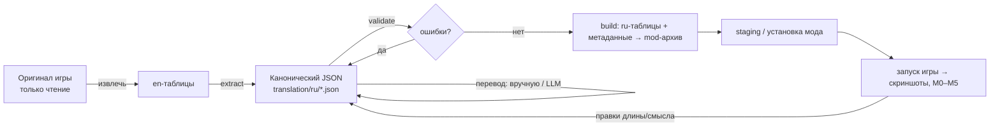

# Конвейер перевода и проверки

[← К оглавлению](../../README.md)



## 1. Этапы и порядок

1. **Разведка (только чтение).** Версия движка, контейнеры, где таблицы, какие языки есть. Хеши оригиналов — в файл, чтобы потом доказать, что они не изменились.
2. **PoC: одна строка.** Заменить одну заметную строку (кнопку главного меню) в существующем языке → увидеть на экране. Это доказывает весь путь: формат, монтирование, приоритет.
3. **PoC: новый язык.** Добавить культуру `ru` с той же одной строкой → язык появился в настройках, строка видна.
4. **Все таргеты по одной строке.** Убедиться, что каждый таргет (меню, настройки, плагины) подхватывает свой `ru`.
5. **Массовый перевод** — только после шагов 2–4.
6. **Итерации по скриншотам:** обрезка, неверный контекст, шрифты.

## 2. Канонический формат

Один JSON на таргет — источник правды для перевода; бинарные таблицы всегда собираются из него.

```json
{
  "format": "l10n/1", "target": "Game", "culture": "ru", "source_culture": "en",
  "entries": [
    {
      "id": "Game/ST_Common_Menu/Menu_Quit",
      "namespace": "ST_Common_Menu", "key": "Menu_Quit",
      "source": "Quit", "source_hash": "0x1A2B3C4D",
      "translation": "Выход",
      "note": "mt:<model> | manual | оставить как в оригинале"
    }
  ]
}
```

- `translation: ""` — не переведено, при сборке остаётся исходный текст.
- `extract` идемпотентен: сохраняет переводы, помечает `stale`, если исходный текст изменился после обновления игры.
- Записи отсортированы по (namespace, key) → чистые диффы в Git.

## 3. Автоматические проверки (validate)

| Проверка | Почему важно |
|---|---|
| плейсхолдеры `{…}` — тот же мультимножественный набор | `{0}` без пары → пустое место или падение форматирования |
| теги `<…>` / `</>` | сломанный rich text показывает разметку как текст |
| служебная разметка диалогов (`(#confirm …)`, `[вариант]`) | скрипт диалога перестанет работать |
| число `\r`/`\n` | вёрстка окон и диалогов |
| ведущие/хвостовые пробелы | строки склеиваются с именами и числами |
| совпадение хеша исходника | перевод не будет принят движком |
| перевод = исходник | предупреждение (часто нормально для названий) |

## 4. Перевод большими объёмами через LLM

Что сработало на ~3800 уникальных строк (~19 тыс. слов):

- **Дедупликация**: одинаковые исходники переводятся один раз (5795 → 3825).
- **Порядок**: сначала таблицы имён (монстры, локации, предметы), их переводы подставляются в следующие партии как мини-глоссарий → единые названия.
- **Глоссарий** в системном промпте + правила: сохранять разметку, «ё», «ёлочки», форма обращения к игроку, нейтральный род.
- **Партии** по ~40 строк / ~6000 символов, ответ — JSON `{id: перевод}`; каждый ответ сразу прогоняется через validate, файл сохраняется после каждой партии (можно прервать и продолжить).
- **Пометка** `note: "mt:<модель>"` — чтобы вычитка знала, что трогал человек, а что нет.
- Выбор модели — короткий слепой тест на 3 строках с разметкой и диалогом у нескольких моделей.

Типичные ошибки машинного перевода, которые ловятся только в игре: многозначные слова без контекста (`Chest` → «Сундук» вместо слота «Торс», `Pack` → «Связка» вместо вкладки «Вещи»), слишком длинные подписи в узких колонках.

## 5. Проверка в игре

- Каждый запуск — с кодом (R1, R2…) и одной изменённой переменной.
- Доказательство, что мод открыт: inotify/Process Monitor, лог параметров запуска.
- Результат — скриншот + код M0–M5 (см. [overview](overview.md#шкала-результата-эксперимента)).
- После каждого запуска — сверка хешей оригиналов.
